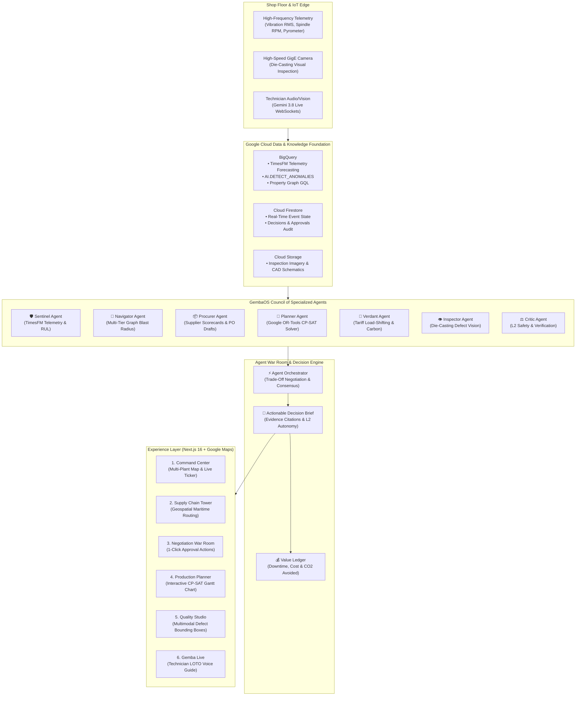

# GembaOS — Gemini at the Gemba 🏭✨
[](https://opensource.org/licenses/Apache-2.0)
[](https://cloud.google.com/)
[](#)
[](https://nextjs.org/)
[](#)

> **An agentic AI operating layer that sees, reasons, and acts across the entire manufacturing value chain.**

GembaOS puts a council of specialized Gemini-powered agents on top of a unified IT/OT data foundation to close the critical decision gap in manufacturing. From predicting high-precision spindle bearing failures before vibration thresholds breach, to re-routing multi-tier global supply chains around typhoons in real-time, GembaOS turns fragmented telemetry into auditable, cross-functional decision briefs and automated ERP/MES actions in minutes.

---

## 🌐 Live Deployments & Endpoints

| Resource | URL | Status | Description |
| :--- | :--- | :--- | :--- |
| **Cloud Run API Gateway** | `https://gembaos-gateway-100149412472.asia-southeast1.run.app` | `LIVE` | Unified FastAPI BFF routing to agent services, optimizer, and telemetry pipelines |
| **API Interactive Swagger** | `https://gembaos-gateway-100149412472.asia-southeast1.run.app/docs` | `LIVE` | OpenAPI 3.0 interactive specification & endpoint documentation |
| **Gateway Health Check** | `https://gembaos-gateway-100149412472.asia-southeast1.run.app/healthz` | `LIVE` | Cloud Run health verification endpoint |
| **GembaOS Web UI** | `http://localhost:3001` *(or Cloud Run Frontend)* | `READY` | Next.js 16 mission control with Google Maps & tactical vector digital twin |

---

## 🏗️ System Architecture



---

## 🤖 The GembaOS Council of Specialized Agents

GembaOS replaces fragmented functional silos with a coordinated multi-agent debate space:

| Agent | Icon | Primary Gemini Model | Specialization & Key Capabilities |
| :--- | :---: | :--- | :--- |
| **Sentinel** | 🛡️ | Gemini 3.8 Flash + TimesFM | Asset reliability & condition monitoring. Detects early stage outer-race bearing spalling on machine `PNQ-CNC-07`, projects Remaining Useful Life (RUL: P10 $26.5\text{h}$, P50 $34.0\text{h}$), and flags spare part crib stock. |
| **Navigator** | 🧭 | Gemini 3.8 Flash + BigQuery Graph | Supply chain intelligence. Executes 5-hop Spanner Graph GQL traversals from external weather disruptions (Typhoon Haikui-2) to tier-1 suppliers (Formosa Semicon), ports (Keelung), and OEM customer delivery commitments. |
| **Procurer** | 📦 | Gemini 3.1 Pro | Strategic sourcing. Audits 25 global suppliers, identifies qualified alternate foundries (Penang Micro), calculates air freight vs sea freight premiums, and auto-drafts ERP purchase orders. |
| **Planner** | 📅 | Google OR-Tools CP-SAT | Discrete-time production scheduling. Solves capable-to-promise (CTP) queries, exploded BOM lead times, and maintenance blackout slots without starving downstream assembly lines. |
| **Verdant** | 🌱 | Gemini 3.8 Flash | Sustainability & decarbonization. Automatically reschedules energy-intensive electric induction melting furnaces from peak tariff windows to off-peak slots ($1.82\text{ t } \text{CO}_2$ avoided). |
| **Critic** | ⚖️ | Gemini 3.1 Pro (Temperature 0.1) | Sceptical auditor and safety guarantor. Verifies physical evidence citations (`[ev:vibe-1]`, `[ev:gql-1]`), validates Lockout/Tagout (LOTO) safety protocols, and vetoes infeasible options. |
| **Inspector** | 👁️ | Gemini 3.8 Flash (Vision) | Computer vision quality engineer. Performs sub-second die-casting inspection, segmenting porosity, cold-shuts, and micro-cracks with normalized bounding box coordinates. |
| **Mentor** | 🎙️ | Gemini 3.8 Live (Audio & Vision) | Hands-free multimodal field assistant. Guides shop floor technicians through spindle replacement via real-time bidirectional WebSocket voice and camera video feed. |
| **Ledger** | 💰 | Deterministic Math Engine | Quantified executive accountability. Tracks cumulative enterprise value protected ($\$2.41\text{M}$ revenue, $31\text{h}$ downtime, $18.2\text{t } \text{CO}_2$). |

---

## 🎬 End-to-End Demo Storylines (Hackathon Jury Presentation)

The built-in **Demo Director** toolbar at the bottom of the UI triggers two pre-seeded, cross-functional storylines:

### Storyline 1: Spindle Bearing Breach on `PNQ-CNC-07`
1. **Trigger:** Click `Bearing Fault (CNC-07)` on the bottom toolbar.
2. **Detection:** RMS vibration jumps from $1.8\text{ mm/s}$ to $2.82\text{ mm/s}$ (threshold $2.5\text{ mm/s}$).
3. **Sentinel Alert:** Flags asset `PNQ-CNC-07` (Line L1, Pune) as `DEGRADING`. RUL estimate is $26.5\text{h}$.
4. **Autonomous Triage:**
   - Spares check: Confirms 18 units of `BRG-6205-C3` available in Pune Crib B.
   - Planner integration: Finds optimal maintenance window on Thursday 14:00 (PM shift) before catastrophic seizure.
5. **War Room:** Sentinel and Planner present a 1-click scheduled work order avoiding $\$125\text{k}$ in unplanned downtime.

### Storyline 2: Typhoon Haikui-2 Disruption & Multi-Tier Graph Blast Radius
1. **Trigger:** Click `Typhoon Haikui-2` on the bottom toolbar.
2. **Weather Disruption:** Category 3 tropical cyclone ($175\text{ km/h}$) makes landfall near Hsinchu & Port of Keelung, Taiwan.
3. **Navigator Blast Radius:** Traverses the BigQuery Graph from `SUP-FORMOSA` $\to$ Gate-Driver IC (`IC-GD-01`) $\to$ Inverter (`TM-300`) $\to$ Open Orders (`SO-1001`, `SO-1002`) $\to$ Automotive OEMs (**Tata Motors** & **Toyota**).
4. **Cross-Agent War Room Debate:**
   - **Option A (Approved):** Split purchase order with alternate supplier **Penang Micro** ($5,000$ units via air freight, $+\$45\text{k}$ expedited cost) + pull ahead Pune assembly shift. Protects $\$1.82\text{M}$ revenue.
   - **Option B:** Single-track air freight charter ($+\$92\text{k}$).
   - **Option C (Rejected by Critic):** Run line until stock-out. Critic drops Option C due to unacceptable OEM line stoppage penalties.
5. **1-Click Authorization:** Plant manager clicks **"Approve Option A"**, dispatching real-time Pub/Sub webhooks to mock ERP and MES services.

---

## 💻 Frontend UI Highlights (`gembaos-ui`)

The UI is built with Next.js 16, Tailwind CSS v4, and DaisyUI 5 Abyss dark styling:

* **Executive Command Center (`/`):**
  * Real-time global KPI ribbon (OEE, OTIF, MTBF, Active Risk).
  * Hybrid **Google Maps Platform** + Tactical Digital Twin vector visualizer with live supply arcs, node status pins, and interactive plant drilldowns (Pune 🇮🇳, Rayong 🇹🇭, Nagoya 🇯🇵).
  * Live Decision Inbox with 1-click human-in-the-loop approvals.
* **Supply Chain Control Tower (`/supply-chain`):**
  * Geospatial route visualizer showing real maritime shipping lanes around the Asian coastline.
  * Live animated Typhoon Haikui-2 radar radius ($380\text{ km}$).
  * Interactive 5-hop graph blast radius analysis with instant BigQuery Graph GQL traversal.
  * Real-time Inventory Runway Ticker with critical BOM stock-out projections.
* **Agent War Room (`/war-room` & `/war-room/[id]`):**
  * Live streaming debate transcripts between Sentinel, Navigator, Procurer, Planner, and Critic.
  * Comparative trade-off matrix evaluating cost, downtime avoided, and delivery reliability.
  * Critic verification badge showing evidence audit status and rejected options.
* **Production Planner (`/planner`):**
  * Google OR-Tools CP-SAT discrete-time solver with 5-minute schedule granularity.
  * Interactive machine Gantt chart with fixed maintenance blackout windows.
  * Capable-To-Promise (CTP) delivery date calculator.
* **Quality Studio (`/quality`):**
  * Multimodal casting inspector detecting porosity, cracks, and flash with normalized bounding box overlays.
* **Gemba Live Assistant (`/live`):**
  * Voice-first technician companion powered by Gemini 3.8 Live over WebSockets with safety Lockout/Tagout (LOTO) verification.

---

## 🛠️ Google Cloud Services & Technologies Used

| Category | Google Cloud Services | Role in GembaOS |
| :--- | :--- | :--- |
| **Foundation Models** | Gemini 3.8 Flash, Gemini 3.1 Pro, Gemini 3.8 Live, Gemini Embedding 2 | Agent reasoning, multimodal vision, real-time voice, and semantic search |
| **Agent Framework** | Google Agent Development Kit (ADK 2.0) on Agent Platform | Multi-agent orchestration, state machines, and tool execution |
| **Safety & Guardrails** | Model Armor | Real-time prompt injection filtering and safety validation |
| **Big Data & Analytics** | BigQuery, TimesFM, BigQuery Graph (GQL), BQML | Telemetry anomaly detection, RUL forecasting, multi-tier supply chain traversal |
| **Real-Time Storage** | Cloud Firestore | Real-time event streams, decision state synchronization, audit logging |
| **Serverless Compute** | Google Cloud Run | Scalable microservices for API Gateway, Simulator, and Optimizer |
| **Event Streaming** | Pub/Sub & Eventarc | Decoupled event-driven messaging between agents and ERP/MES actuators |
| **Optimization** | Google OR-Tools CP-SAT Engine | Mathematical discrete-time production scheduling and CTP constraint solving |
| **Geospatial & Mapping** | Google Maps JavaScript API | Dark-styled multi-plant status map and maritime logistics visualizer |

---

## 🚀 Quickstart & Local Setup

### Prerequisites
* **Node.js:** `v20.x` or higher
* **Python:** `3.11+`
* **Google Cloud SDK (`gcloud`):** Authenticated with project permissions

### 1. Run the Frontend Locally
```powershell
cd gembaos-ui
npm install
npm run dev
```
Open **`http://localhost:3001`** in your browser.

> [!TIP]
> **Google Maps API Key:** If you have a Google Maps JavaScript API key, click the **"Connect Google Maps"** button on the map toolbar or set `GOOGLE_MAPS_API_KEY` in your Cloud Run environment variables. The app automatically caches and loads the key across all screens.

### 2. Run Backend Services Locally (Optional)
Use the included PowerShell helper script from the repository root:
```powershell
# Run API Gateway BFF locally on port 8000
.\run.ps1 gateway

# Run Factory Simulator on port 8082
.\run.ps1 simulator

# Run CP-SAT Optimizer on port 8084
.\run.ps1 optimizer
```

### 3. Deploy to Google Cloud Run
To deploy the backend gateway:
```powershell
.\run.ps1 deploy
```

To build and run the frontend in a production container:
```powershell
cd gembaos-ui
docker build -t gembaos-ui .
docker run -p 3001:3001 -e GOOGLE_MAPS_API_KEY="AIzaSy..." gembaos-ui
```

---

## 👥 Hackathon Submission & Team

* **Event:** Google AI Builder Cup 2026
* **Category:** Enterprise & Manufacturing AI / Autonomous Agent Workflows
* **Target Industry:** Automotive & Electronics Manufacturing (Nova Drive Tier-1 Powertrain Supplier)
* **License:** Apache 2.0