# GembaOS — Frontend UI to Backend API Mapping Specification

This document maps every screen, panel, and component in the **GembaOS Next.js Frontend** to its corresponding **Backend REST Endpoints**, **Firestore Real-Time Collections**, and **WebSockets**.

---

## 🌐 Base Architecture & Host URL

- **Production Cloud Run Gateway:**  
  `https://gembaos-gateway-100149412472.asia-southeast1.run.app`
- **Local API Gateway BFF:**  
  `http://localhost:8000`
- **Local Optimizer Engine:**  
  `http://localhost:8084`
- **Firestore Native Project:**  
  `deep-atlas-511314-r4` (`asia-southeast1`)

---

## 🗺️ Master Mapping Overview

```mermaid
flowchart TD
    subgraph UI_Pages["Frontend UI Pages (Next.js 16)"]
        CC["1. Command Center (Home)"]
        AD["2. Asset Detail (PNQ-CNC-07)"]
        WR["3. War Room Negotiation"]
        PL["4. Production Planner & CTP"]
        GL["5. Gemba Live Voice/Vision"]
        QS["6. Quality Studio (Inspection)"]
        CP["7. Copilot Drawer (Global)"]
        DD["8. Demo Director Toolbar"]
    end

    subgraph API_Endpoints["Backend API Gateway & Services"]
        E1["/v1/kpis & /v1/value-ledger"]
        E2["/v1/plants & /v1/me"]
        E3["/v1/insights & /v1/decisions"]
        E4["/v1/assets/{id} & /v1/assets/{id}/telemetry"]
        E5["/v1/assets/{id}/health"]
        E6["/v1/graph/blast-radius"]
        E7["/v1/decisions/{id}/approve"]
        E8["/v1/schedule/solve & /v1/ctp & /v1/mrp"]
        E9["WS /ws/live"]
        E10["POST /v1/inspections"]
        E11["POST /v1/chat (SSE)"]
        E12["POST /v1/demo/scenarios/..."]
    end

    CC --> E1
    CC --> E2
    CC --> E3
    CC --> E7
    AD --> E4
    AD --> E5
    WR --> E3
    WR --> E6
    WR --> E7
    PL --> E8
    GL --> E9
    QS --> E10
    CP --> E11
    DD --> E12
```

---

## 1. Global Shell & Navigation Header

Always visible across all pages in the app layout.

| UI Component | Backend Endpoint / Resource | Method | Real-Time Mechanism | Purpose & Payload |
|---|---|---|---|---|
| **User Profile & Role Pill** | `/v1/me` | `GET` | REST on session init | Returns active user name (`Sarah Chen`), email, roles (`plant_manager`, `planner`, etc.), and allowed plants (`PNQ`, `RYG`, `NGO`). |
| **Plant Selector Dropdown** | `/v1/plants` | `GET` | REST / Cached | Lists all plants: Pune (`PNQ`), Rayong (`RYG`), Nagoya (`NGO`) with country flags and timezones. |
| **Value Ledger Ticker** | `/v1/value-ledger` or Firestore `/valueLedger/summary` | `GET` | Firestore `onSnapshot` / REST | Running totals: **$2.41M** value protected, **31 h** downtime avoided, **18.2 t** CO2 avoided. |
| **Active Alerts Counter** | `/v1/insights?status=new` | `GET` | Firestore `onSnapshot` / REST | Badge indicator showing unacknowledged critical/high insights count. |

---

## 2. Command Center View (`/` or `/command-center`)

The executive mission-control dashboard showing enterprise-wide health, live anomalies, and pending decisions.

| UI Section / Card | Backend Endpoint / Source | Method | Response / Payload Structure | Key Fields Displayed |
|---|---|---|---|---|
| **Global KPI Ribbon** | `/v1/kpis?scope={scope}` | `GET` | `{ kpis: { oee_pct, otif_pct, mtbf_hours, mttr_hours, revenue_at_risk_usd, co2_intensity_kg_per_unit } }` | OEE gauge (`78.4%`), OTIF progress (`94.2%`), MTBF (`142h`), Active Risk (`$793.5k`). |
| **Multi-Plant Status Map** | `/v1/plants` + Firestore `/plants/{id}` | `GET` | `[ { plant_id: "PNQ", status: "ATTENTION_REQUIRED", active_anomalies: 1 } ]` | Interactive dark map pins: Pune (amber warning), Rayong (green), Nagoya (green). |
| **Live Event Stream** | `/v1/insights?status=new` or Firestore `/insights` | `GET` | `{ insights: [ { id, ts, domain, severity, title, summary, agent, evidence_ids } ] }` | Real-time card feed: CNC-07 bearing breach (`Sentinel`), Typhoon Haikui-2 warning (`Scout`). |
| **Decision Inbox** | `/v1/decisions?status=pending` or Firestore `/decisions` | `GET` | `{ decisions: [ { decision_id, title, autonomy_level, est_value_usd, options, blast_radius } ] }` | Cards showing cross-functional War Room proposals awaiting human authorization. |
| **1-Click Approve Button** | `/v1/decisions/{decision_id}/approve` | `POST` | `Body: { option_id: "OPT-A", comment: "Approved via Command Center" }` | Authorizes actions, updates Firestore, and pushes event to Pub/Sub `decisions.approved`. |
| **1-Click Reject Button** | `/v1/decisions/{decision_id}/reject` | `POST` | `Body: { reason: "Postpone to next shift" }` | Marks decision rejected with audit trail. |

---

## 2b. Plant & Production Line View (`/plants/[id]` or `/operations`)

Dedicated operational view for plant managers drill-down into specific plants and lines.

| UI Section / Card | Backend Endpoint | Method | Key Parameters | Key Fields Displayed |
|---|---|---|---|---|
| **Plant Overview Card** | `/v1/plants/{plant_id}` | `GET` | `plant_id="PNQ"` | Plant name, location, timezone, key products, and primary manufacturing processes. |
| **Plant-Specific KPI Ribbon** | `/v1/kpis?plant_id={plant_id}` or `?scope=plant:{plant_id}` | `GET` | `plant_id="PNQ"` or `"RYG"` or `"NGO"` | Plant OEE (Pune: `76.8%`, Rayong: `81.2%`, Nagoya: `89.5%`), OTIF, MTBF, MTTR, Scrap %, active anomalies count. |
| **Production Lines Card** | `/v1/plants/{plant_id}/lines` | `GET` | `plant_id="PNQ"` | List of lines (`PNQ-L1`, `PNQ-L2`), operational status (`DEGRADED` vs `RUNNING`), line-level OEE %, bottleneck asset. |
| **Plant Insights Feed** | `/v1/insights?plant={plant_id}` | `GET` | `plant="PNQ"` | Filtered operational alerts for that specific facility (e.g., CNC-07 bearing breach in Pune, die casting porosity in Rayong). |

---

## 3. Asset Detail View (`/assets/[id]`, e.g. `/assets/PNQ-CNC-07`)

Deep-dive operational view for reliability engineers and maintenance leads.

| UI Section / Card | Backend Endpoint | Method | Key Parameters | Key Fields Displayed |
|---|---|---|---|---|
| **Asset Header** | `/v1/assets/{asset_id}` | `GET` | `asset_id="PNQ-CNC-07"` | Name (`CNC Milling Center 07`), Line (`PNQ-L1`), Criticality (`CRITICAL`), Status (`DEGRADING`). |
| **Vibration Telemetry Chart** | `/v1/assets/{asset_id}/telemetry` | `GET` | `minutes=60`, `metric="vib_rms"` | Time-series curve of RMS vibration (breaching threshold `2.5 mm/s` up to `2.82 mm/s`) and kurtosis. |
| **Sentinel RUL Card** | `/v1/assets/{asset_id}/health` | `GET` | `asset_id="PNQ-CNC-07"` | Health score: **62/100**, Failure mode: **Outer-race bearing spalling**, P10 RUL: **26.5 h**, P50: **34.0 h**, P90: **48.0 h**. |
| **Spares & Stock Check** | `/v1/assets/{asset_id}/health` | `GET` | `asset_id="PNQ-CNC-07"` | Required part: `BRG-6205`, On-hand status: **Available (18 units in Pune Crib B)**. |
| **Recommended Maintenance Window** | `/v1/assets/{asset_id}/health` | `GET` | `asset_id="PNQ-CNC-07"` | Suggested slot: **Thursday 14:00 (PM shift)** before P10 RUL window. |

---

## 4. War Room Negotiation View (`/war-room/[id]`)

Cross-functional agent negotiation space where Sentinel, Navigator, Procurer, Planner, and Critic debate trade-offs.

| UI Component | Backend Endpoint | Method | Response / Payload | Purpose |
|---|---|---|---|---|
| **Brief Overview Banner** | `/v1/decisions` (filtered by ID) | `GET` | Title, summary, autonomy level (`L2`), estimated value protected (`$793.5k` or `$125k`). | Context card explaining the root cause disruption. |
| **Graph Blast Radius Card** | `/v1/graph/blast-radius` | `GET` | `?event_type=weather&entity_id=SUP-FORMOSA` | Visualizes supply chain downstream impact: supplier $\to$ part (`IC-GD-01`) $\to$ SKU (`TM-300`) $\to$ orders (`SO-1001`, `SO-1002`) $\to$ customer (**Tata Motors**, **Toyota**). |
| **Option Comparison Matrix** | `/v1/decisions` (embedded `options[]`) | `GET` | `options: [ { option_id: "OPT-A", est_cost_usd, est_value_usd, downtime_hours_avoided, actions } ]` | Side-by-side comparison: **Option A** (Dual-track PO split + shift pull-ahead) vs **Option B** (Air freight charter). |
| **Critic Verdict Badge** | `/v1/decisions` (`critic_verdict`) | `GET` | `{ verdict: "PASS", audited_claims: 3, issues: [], dropped_options: ["OPT-C"] }` | Sceptical auditor badge confirming evidence citations and safety LOTO protocols. Shows rejected Option C. |
| **Action Execution Timeline** | `/v1/decisions` (`actions[]`) | `GET` | List of actions: ERP PO draft (`act_po_penang`), MES rescheduling (`act_reschedule_ngo`), CRM customer email draft (`act_notify_kirin`). | Displays executable actions dispatched upon approval. |
| **Authorize Decision Button** | `/v1/decisions/{id}/approve` | `POST` | `Body: { option_id: "OPT-A" }` | Final 1-click authorization that executes the actions. |

---

## 5. Production Planner & Capable-To-Promise (`/planner` or `/schedule`)

Solver-backed planning view powered by Google OR-Tools CP-SAT discrete-time optimizer.

| UI Component | Backend Endpoint | Method | Request Body / Query | Result Rendered |
|---|---|---|---|---|
| **CP-SAT Interactive Gantt Chart** | `/v1/schedule/solve` | `POST` | `{ horizon_days: 7, operations: [...] }` | 5-minute discretized schedule slots across machines (`PNQ-CNC-07`, `08`, `11`), respecting fixed maintenance blackout windows. Status: `OPTIMAL`. |
| **Capable-To-Promise (CTP) Calculator** | `/v1/ctp` | `POST` | `{ sku_id: "TM-300", qty: 500, customer_id: "CUST-KIRIN", due_date: "2026-10-25" }` | Evaluates BOM explosion (`IC-GD-01`, `BRG-6205`), calculates earliest feasible delivery date, and outputs delivery split options (`OPT-SPLIT`, `OPT-EXPEDITE`). |
| **MRP Net Requirements Table** | `/v1/mrp` | `POST` | `{ horizon_weeks: 4 }` | Table showing gross demand, on-hand inventory, open purchase orders, and recommended PO release dates. |
| **Energy Load-Shifting Card** | `/v1/loadshift` | `POST` | `{ plant_id: "NGO" }` | Optimization shifting electric induction furnaces from peak to off-peak tariff hours ($680 savings, 1.82 t CO2 avoided). |

---

## 6. Gemba Live Audio & Vision Assistant (`/live`)

Voice-first, hands-free assistant for floor technicians on mobile/tablet.

| UI Component | Protocol & Endpoint | Format | Behavior & Purpose |
|---|---|---|---|
| **Gemba Live Voice Session** | `wss://<gateway-host>/ws/live` | WebSocket (Raw PCM 16kHz audio) | Full-duplex voice conversation with Gemini 3.8 Live. Guides the technician step-by-step through repairs. |
| **Safety LOTO Checklist Overlay** | Received via Live WebSocket tool calls | JSON event: `get_asset_status` | Prompts technician to verify Lockout/Tagout (LOTO) on **Q1 main isolator** before touching the spindle. |
| **Camera View Inspection** | `wss://<gateway-host>/ws/live` | Video/Image frames (JPEG) | Technician points mobile camera at machine parts for visual inspection and alignment confirmation. |

---

## 7. Quality Studio — Casting Inspector (`/quality`)

Multimodal computer vision defect detection on high-pressure die castings.

| UI Component | Backend Endpoint | Method | Payload / Request | Output Rendered |
|---|---|---|---|---|
| **Image Upload & Defect Scanner** | `/v1/inspections` | `POST` | `multipart/form-data: image file (casting.jpg)` | Two-stage analysis: Stage 1 Flash-Lite screening $\to$ Stage 2 Gemini 3.8 Flash few-shot reasoning. |
| **Annotated Bounding Box Canvas** | Returned from `/v1/inspections` | `GET` / Inline | `boxes: [ { label: "porosity", box_2d: [ymin, xmin, ymax, xmax] } ]` | Overlays bounding boxes highlighting defects (porosity, cracks, cold-shut, flash) on the casting image. |

---

## 8. Copilot Drawer (Universal Chat Overlay)

Available via slide-out drawer on every screen across the app.

| UI Feature | Backend Endpoint | Protocol | Input | Output |
|---|---|---|---|---|
| **Ask GembaOS Assistant** | `/v1/chat` | `POST` (SSE / Stream) | `{ message: "Why is OEE down in Pune?", context: { page: "/assets/PNQ-CNC-07" } }` | Streams tokens with agent reasoning, SQL dry-run query, Vega-Lite chart spec, and citations. |
| **Lane A Live Web Intelligence** | `/v1/chat` (routed to `Live-web`) | `POST` | `{ message: "Current typhoon alerts in Taiwan" }` | Returns real-time Google Search results with verified source links and timestamps. |

---

## 9. Demo Director Toolbar (Jury Presentation)

Floating sticky bar at the bottom of the screen to trigger pre-seeded demo storylines.

| Toolbar Button | Endpoint Called | Method | Triggered Storyline |
|---|---|---|---|
| **Trigger: CNC-07 Bearing Failure** | `/v1/demo/scenarios/bearing_failure_cnc07/start` | `POST` | Simulates Wednesday 07:00, injects outer-race bearing fault on `PNQ-CNC-07`, triggers vibration breach $\to$ Sentinel $\to$ War Room. |
| **Trigger: Typhoon Haikui-2** | `/v1/demo/scenarios/typhoon_hsinchu/start` | `POST` | Injects Category 4 typhoon warning over Hsinchu, disrupts Formosa Semiconductor $\to$ Navigator blast radius $\to$ War Room. |
| **Reset Demo State** | `/v1/demo/reset` | `POST` | Stops simulator, resets asset wear models, clears active alerts. |

---

## 10. Summary Quick Reference Table

| Path | Primary HTTP Method | Frontend Page / Hook | Backend File |
|---|---|---|---|
| `/healthz` | `GET` | Health Check / Monitoring | `backend/services/api_gateway/main.py` |
| `/v1/me` | `GET` | Global Shell (`useUser`) | `backend/services/api_gateway/main.py` |
| `/v1/plants` | `GET` | Header & Map (`usePlants`) | `backend/services/api_gateway/main.py` |
| `/v1/kpis` | `GET` | Command Center (`useKpis`) | `backend/services/api_gateway/main.py` |
| `/v1/value-ledger` | `GET` | Ticker / Value Banner | `backend/services/api_gateway/main.py` |
| `/v1/assets/{id}` | `GET` | Asset Detail (`useAsset`) | `backend/services/api_gateway/main.py` |
| `/v1/assets/{id}/telemetry` | `GET` | Asset Detail Telemetry Chart | `backend/services/api_gateway/main.py` |
| `/v1/assets/{id}/health` | `GET` | Asset Detail Sentinel Card | `backend/services/api_gateway/main.py` |
| `/v1/insights` | `GET` | Command Center Alerts Feed | `backend/services/api_gateway/main.py` |
| `/v1/decisions` | `GET` | Decision Inbox & War Room | `backend/services/api_gateway/main.py` |
| `/v1/decisions/{id}/approve` | `POST` | 1-Click Approval Action | `backend/services/api_gateway/main.py` |
| `/v1/graph/blast-radius` | `GET` | War Room Downstream Impact | `backend/services/api_gateway/main.py` |
| `/v1/schedule/solve` | `POST` | Planner CP-SAT Gantt Chart | `backend/services/optimizer/main.py` |
| `/v1/ctp` | `POST` | CTP Order Feasibility Checker | `backend/services/optimizer/main.py` |
| `/v1/mrp` | `POST` | MRP Net Requirements Table | `backend/services/optimizer/main.py` |
| `/v1/loadshift` | `POST` | Sustainability & Tariff Shifting | `backend/services/optimizer/main.py` |
| `/v1/chat` | `POST` | Copilot Drawer (SSE) | `backend/services/api_gateway/main.py` |
| `/v1/demo/scenarios/{id}/start`| `POST` | Demo Director Floating Toolbar | `backend/services/simulator/main.py` |
| `/v1/demo/reset` | `POST` | Demo Director Reset Button | `backend/services/simulator/main.py` |

